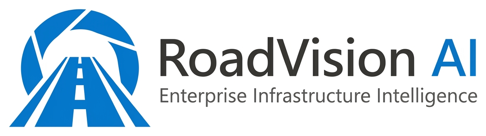
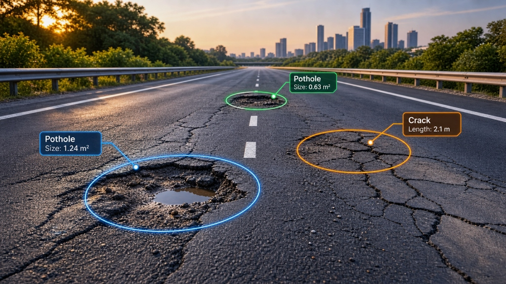

# RoadVision AI — Enterprise Road Infrastructure Intelligence & Visual Benchmark

<div align="center">
  
  <p><strong>Automated Visual Task Factory & Deterministic Multimodal Reasoning Benchmark</strong></p>

  [](https://www.python.org/)
  [](https://github.com/tIILUNGI/rodvision-ia)
  []()
  []()
  []()
</div>

---

## 🌍 Language Navigation / Navegação de Idioma / भाषा नेविगेशन
- [🇬🇧 English Documentation](#-english-documentation)
- [🇵🇹 Documentação em Português](#-documentação-em-português)
- [🇮🇳 हिन्दी प्रलेखन (Hindi Documentation)](#-हिन्दी-प्रलेखन-hindi-documentation)

---



---

## 🇬🇧 English Documentation

### 1. Overview
**RoadVision AI** is an enterprise-grade automated **Visual Task Factory** and scientific benchmarking framework designed to evaluate and stress-test multimodal foundation vision models (e.g., Llama 3.2 Vision, GPT-4o, Claude 3.5 Sonnet, Gemini Pro Vision) on complex infrastructure reasoning.

Unlike simple pothole detection models, RoadVision AI is an end-to-end procedural generation and evaluation factory that creates photorealistic road pavement scenes, calculates pixel-exact Ground Truth directly from binary masks without AI guesswork, generates leakage-free reasoning tasks, and deterministically validates model outputs without subjective LLM-as-a-judge dependencies.

### 2. Core Capabilities (The 7 Cognitive Dimensions)
RoadVision AI evaluates multimodal models across 7 distinct reasoning capabilities:
1. **Defect Counting & Density**: Tests whether the model accurately counts distinct potholes, cracks, and repairs without double-counting.
2. **Severity Classification**: Distinguishes structural deep craters from superficial surface wear, alligator cracking, and bitumen patches.
3. **Bounding Box Localization**: Evaluates normalized coordinates `[ymin, xmin, ymax, xmax]` scored via strict Intersection over Union (IoU) thresholds.
4. **Spatial Topology Reasoning**: Verifies relative orientation (e.g., determining whether a defect lies to the left, right, foreground, or behind other road features).
5. **Metric Area Comparison**: Compares physical surface footprints in real-world square meters, testing projected dimensional reasoning.
6. **Occlusion & Weather Robustness**: Tests resilience when anomalies are partially hidden by shadows, standing water puddles, or debris.
7. **Evidence Sufficiency & Honest Abstention**: Rewards models that explicitly refuse to guess ("insufficient evidence") under severe degradation or low visibility.

### 3. System Architecture
```
┌─────────────────────────────────────────────────────────────────────────┐
│                          RoadVision AI Architecture                     │
├──────────────────────┬──────────────────────┬───────────────────────────┤
│ 1. Scenario Config   │ 2. Procedural Engine │ 3. Ground Truth Generator │
│ (Seeds, YAML, RNG)   │ (Asphalt, Weather)   │ (Pixel Masks, IoU, Area)  │
├──────────────────────┼──────────────────────┼───────────────────────────┤
│ 4. Task Factory      │ 5. Model Inference   │ 6. Deterministic Verifier │
│ (7 Capabilities)     │ (Multimodal APIs)    │ (Zero LLM Judges, Math)   │
├──────────────────────┴──────────────────────┴───────────────────────────┤
│ 7. Harbor Framework Export (task.toml, instruction.md, tests/test.sh)   │
└─────────────────────────────────────────────────────────────────────────┘
```

### 4. Quick Start

#### Prerequisites
- Python 3.12 or higher
- Git

#### Installation
```bash
# Clone the repository
git clone https://github.com/tIILUNGI/rodvision-ia.git
cd rodvision-ia

# Create and activate virtual environment
python -m venv .venv
# On Windows:
.venv\Scripts\activate
# On Linux/macOS:
source .venv/bin/activate

# Install dependencies
pip install -r requirements.txt
pip install -e .
```

#### Launch the Web Application
```bash
python -m uvicorn roadvision.api.app:app --host 0.0.0.0 --port 8000
```
Open **`http://localhost:8000`** in your browser.

#### CLI Commands
```bash
# Generate a procedural scene with tasks
roadvision generate --config configs/smoke.yaml --seed 10452 --show-tasks

# Build a dataset split
roadvision build-dataset --config configs/dev.yaml

# Run benchmark evaluation
roadvision evaluate --dataset smoke --provider mock --model roadvision-sota

# Export to official Harbor 1.4 format
roadvision export-harbor --dataset smoke --output benchmarks/harbor_export

# Run test suite (18/18 passing)
pytest tests/ -v
```

### 5. Harbor Framework v1.4 Native Integration
RoadVision AI natively exports benchmarks adhering strictly to the **Harbor Specification (v1.4)**:
- `task.toml`: Container timeout, schema version 1.4, and hardware requirements.
- `instruction.md`: Public model-facing prompt with prompt-leakage prevention.
- `tests/test.sh`: Deterministic grading script scoring answers into `/tmp/reward`.
- `solution/solve.sh`: Verified oracle solution.

---

## 🇵🇹 Documentação em Português

### 1. Visão Geral
O **RoadVision AI** é uma **Fábrica Automatizada de Tarefas Visuais** e uma plataforma científica de benchmarking de Inteligência Artificial para avaliar modelos multimodais de visão em infraestruturas rodoviárias.

Não é um simples detetor de buracos. É uma infraestrutura de engenharia capaz de criar cenários com física controlada, gerar perguntas sem fuga de dados (*data leakage*), estabelecer respostas verdadeiras a partir de máscaras de píxeis e validar os resultados através de verificadores determinísticos sem juízes LLM.

### 2. As 7 Dimensões de Raciocínio Visual
1. **Contagem e Densidade**: Mede a capacidade de contar anomalias distintas sem duplicação.
2. **Classificação de Severidade**: Distingue crateras estruturais profundas de desgaste superficial, fissuração em couro de crocodilo e remendos de asfalto.
3. **Localização por Bounding Box**: Avalia coordenadas normalizadas `[ymin, xmin, ymax, xmax]` através de Intersection over Union (IoU).
4. **Topologia e Relações Espaciais**: Avalia o raciocínio posicional (à esquerda, à direita, à frente ou atrás de outros elementos).
5. **Comparação Métrica de Área**: Compara dimensões reais projetadas em metros quadrados.
6. **Robustez a Oclusão e Clima**: Testa modelos sob poças de água, sombras solares e detritos.
7. **Suficiência de Evidência e Abstenção**: Bonifica modelos que declaram "evidência insuficiente" em condições degradadas em vez de alucinar.

### 3. Instalação e Execução
```bash
# Clonar o repositório
git clone https://github.com/tIILUNGI/rodvision-ia.git
cd rodvision-ia

# Criar ambiente virtual
python -m venv .venv
.venv\Scripts\activate   # Windows
# source .venv/bin/activate # Linux/Mac

# Instalar dependências
pip install -r requirements.txt
pip install -e .

# Iniciar o servidor web
python -m uvicorn roadvision.api.app:app --host 0.0.0.0 --port 8000
```
Acesse **`http://localhost:8000`** no seu navegador.

### 4. Módulos do Sistema Interno
- **Agente Neural Multimodal**: Diagnóstico por visão computacional com OpenCV e segmentação de contornos.
- **Studio de Criação**: Geração paramétrica de asfalto, seleção de clima (seco, húmido, poças de chuva), iluminação solar e inspeção de camadas (`RGB`, `Instâncias`, `Visibilidade`, `Oclusores`, `BBoxes`).
- **Auditoria Ground Truth**: Inspeção de máscaras e coordenadas com validação Pydantic.
- **Validation Arena**: Teste determinístico de respostas em tempo real.
- **Benchmark & Ranking**: Tabela de classificação e gráfico radar das 7 capacidades.
- **Harbor Export Hub**: Exportação em 1 clique de ficheiros `.zip` prontos para submissão.

---

## 🇮🇳 हिन्दी प्रलेखन (Hindi Documentation)

### 1. अवलोकन (Overview)
**RoadVision AI** सड़क अवसंरचना के मूल्यांकन के लिए एक स्वचालित **विजुअल टास्क फैक्ट्री (Visual Task Factory)** और वैज्ञानिक बेंचमार्किंग प्लेटफॉर्म है। यह मल्टीमॉडल एआई मॉडलों (जैसे Llama Vision, GPT-4o, Claude) की दृश्य समझ का सटीक और निष्पक्ष परीक्षण करता है।

यह केवल गड्ढों का पता लगाने वाला सामान्य मॉडल नहीं है, बल्कि प्रक्रियात्मक दृश्य निर्माण, पिक्सेल-सटीक ग्राउंड ट्रुथ (Ground Truth), और बिना किसी LLM जज के 100% गणितीय सत्यापन प्रदान करने वाला संपूर्ण सिस्टम है।

### 2. 7 संज्ञानात्मक आयाम (The 7 Capabilities)
1. **दोष गणना और घनत्व (Counting)**: एकाधिक गड्ढों और दरारों की सटीक गिनती।
2. **गंभीरता वर्गीकरण (Classification)**: गहरे संरचनात्मक गड्ढों और सतही दरारों के बीच अंतर।
3. **बाउंडिंग बॉक्स स्थानीयकरण (Localization)**: सामान्यीकृत निर्देशांकों का IoU गणितीय सत्यापन।
4. **स्थानिक संबंध तर्क (Spatial Relations)**: सड़क की विशेषताओं के सापेक्ष बाएं, दाएं, आगे या पीछे की स्थिति का तर्क।
5. **क्षेत्रफल एवं मीट्रिक तुलना (Area Comparison)**: वास्तविक वर्ग मीटर में विसंगतियों के आकार की तुलना।
6. **अवरोध एवं मौसम मजबूती (Occlusion & Weather)**: बारिश के पानी, छाया और मलबे के तहत दृश्य मजबूती।
7. **साक्ष्य पर्याप्तता और परहेज (Abstention)**: कम दृश्यता में मनगढ़ंत उत्तर देने के बजाय इनकार करने की क्षमता।

### 3. त्वरित शुरुआत (Quick Start)
```bash
# रिपॉजिटरी क्लोन करें
git clone https://github.com/tIILUNGI/rodvision-ia.git
cd rodvision-ia

# वर्चुअल एनवायरनमेंट बनाएं और सक्रिय करें
python -m venv .venv
.venv\Scripts\activate   # Windows
# source .venv/bin/activate # Linux/Mac

# निर्भरताएं स्थापित करें
pip install -r requirements.txt
pip install -e .

# वेब सर्वर शुरू करें
python -m uvicorn roadvision.api.app:app --host 0.0.0.0 --port 8000
```
ब्राउज़र में **`http://localhost:8000`** खोलें।

### 4. हार्बर 1.4 ओपन स्टैंडर्ड (Harbor Framework Native)
RoadVision AI सीधे आधिकारिक हार्बर 1.4 प्रारूप में कार्यों का निर्यात करता है:
- `task.toml`: कार्य विनिर्देश एवं समय सीमा।
- `instruction.md`: बिना डेटा रिसाव के मॉडल निर्देश।
- `tests/test.sh`: स्वचालित स्कोरिंग स्क्रिप्ट।
- `solution/solve.sh`: सत्यापित संदर्भ समाधान।

---

## 📄 License
This project is licensed under the MIT License — see the [LICENSE](LICENSE) file for details.
© 2026 RoadVision AI. All rights reserved.
